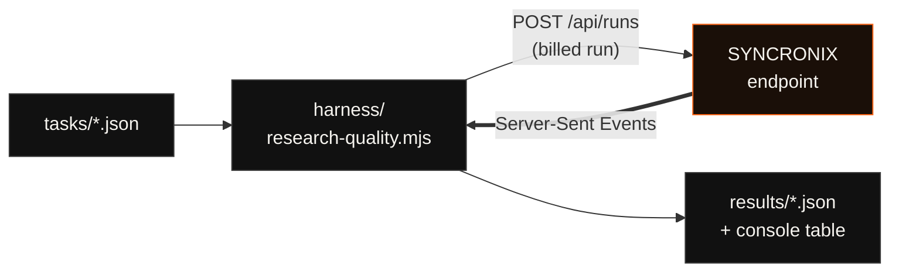

<p align="center">
  
</p>

<h1 align="center">SYNCRONIX Benchmarks</h1>

<p align="center">
  Does the research agent read and cite its sources, is wallet data verified, does the API behave as documented, and does a transfer preview stay valid?<br>
  <a href="https://syncronixai.xyz">Website</a> · <a href="https://github.com/SyncronixLabs/syncronix-docs">Docs</a> · <a href="https://github.com/SyncronixLabs/syncronix-research">Research</a> · <a href="https://github.com/SyncronixLabs/syncronix-docs/blob/main/whitepaper.md">Whitepaper</a> · <a href="CHANGELOG.md">Changelog</a>
</p>

---

## Research quality

### What is measured



| Metric | Definition |
|---|---|
| **Pages read** | Distinct pages successfully fetched and read in full (not search snippets) |
| **Findings citing a read page** | Bullets under *Findings* that link to at least one page that was read |
| **Unsourced findings** | Findings with no link |
| **Single-source findings** | Findings the agent marked *(single source)* |
| **Cited passages** | Passage-level citations the API attached to the report text |
| **Sources traced** | Report links that trace to a real search result or fetched page / all report links |
| **Repeated searches / fetches** | Identical queries or pages issued more than once in a run |
| **Cost** | List-price estimate from API-reported token usage plus search fees |
| **Within ceiling** | Cost ≤ the per-run ceiling ($0.20) |

### Latest results

*13 Nov 2026 · claude-sonnet-5-5 · local build of the production agent*

| Configuration | Task | Pages read | Findings citing a read page | Repeats | Cited passages | Cost |
|---|---|---|---|---|---|---|
| Baseline (production) | similar to T1 | 0 | — | 1 search | — | $0.082 |
| Protocol + dynamic-filtering tools | T1 | 3 | 5/5 | 3 searches + fetches | 0 | $0.106 |
| Protocol + dynamic-filtering tools | T2 | 2 | 1/4 | fetches | 0 | $0.085 |
| **Protocol + direct-call tools (current)** | T1 | 2 | 6/8 | none | 17 | **$0.069** |
| **Protocol + direct-call tools (current)** | T2 | 2 | 5/5 | none | 2 | **$0.040** |

**T1** — *How does Solana's Proof of History work, and is it being replaced?*
**T2** — *What is the current Node.js Active LTS release line and when does it reach end of life?*

> [!IMPORTANT]
> Single runs of two tasks. Treat the results as directional, not as statistically established.
> Raw data: [results/2026-11-13-research-quality.json](results/2026-11-13-research-quality.json) ·
> analysis: [syncronix-research](https://github.com/SyncronixLabs/syncronix-research/blob/main/notes/2026-11-grounded-web-research.md).

### Run the benchmark

Node.js 18+, no dependencies. **Each task starts one billed research run** on the server you point it at.

```bash
# a self-hosted SYNCRONIX instance
node harness/research-quality.mjs --base http://localhost:3100

# the public service: one run per visitor per day, so use a single task
node harness/research-quality.mjs --base https://syncronixai.xyz --tasks tasks/one.json
```

<details>
<summary><b>Options</b></summary>

| Option / variable | Default | Meaning |
|---|---|---|
| `--base` | `http://localhost:3100` | Endpoint to test |
| `--tasks` | `tasks/default.json` | JSON array of task strings |
| `--out` | `results/run-<timestamp>.json` | Where to write results |
| `SYNCRONIX_ADMIN_KEY` | — | Admin key of your own instance (lifts the per-visitor daily limit there) |
| `RUN_CEILING_USD` | `0.20` | Ceiling used for the *within ceiling* check |

</details>

<details>
<summary><b>Result file format</b></summary>

```json
{
  "base": "http://localhost:3100",
  "ranAt": "2026-11-13T04:50:00.000Z",
  "ceilingUsd": 0.2,
  "rows": [
    {
      "task": "…",
      "seconds": 23,
      "costUsd": 0.06853,
      "searches": 2,
      "repeatedSearches": 0,
      "pagesRead": 2,
      "repeatedFetches": 0,
      "findings": 8,
      "findingsCitingReadPage": 6,
      "unsourcedFindings": 0,
      "singleSourceFindings": 0,
      "citedPassages": 17,
      "sourcesTraced": "7/7",
      "withinCeiling": true,
      "notes": ["Source check: …", "Grounding: …"]
    }
  ]
}
```

A run refused before it starts records `refused`; a run that fails records `failed`.

</details>

## Wallet Intelligence benchmark

Does Wallet Intelligence return verified, cross-checked data, how fast, and what would an AI brief cost?
The harness is **read-only and free**: it calls the Activity and Funding-trace endpoints and the AI *estimate*, and
never starts an AI analysis.

| Metric | Definition |
|---|---|
| **Activity / trace time** | Wall-clock time of the API response, first request and repeat |
| **RPC cross-check** | The newest indexed transaction re-read from the official RPC: sender, recipient and value match |
| **First funder proven** | The indexer's internal-transfer history up to the first inflow was complete |
| **Evidence** | Graph edges labelled `verified` (an on-chain transfer) vs. `inferred` (a shared-funder pattern) |
| **Links on explorer** | Response URLs that point to Robinscan (mainnet) or the testnet explorer |
| **Key leaks** | Responses containing an API-key parameter (must be 0) |
| **AI estimate** | Estimated and maximum cost shown before a visitor may click *Analyze with AI* |

### Latest results

*19 Nov 2026 · production (release ce78c9a) · 4 mainnet + 1 testnet address · 0 AI calls*

| Wallet | Activity (first / cached) | Trace | Hops · stop | First funder | Graph edges | AI estimate (max) |
|---|---|---|---|---|---|---|
| W1 mainnet | 4.7 s / 0.42 s | 0.41 s (cached) | 5 · contract | earliest found, `rpc` | 5 verified | $0.00114 ($0.00202) |
| W2 mainnet | 5.8 s / 0.46 s | 1.7 s | 4 · contract | earliest found, `rpc` | 4 verified | $0.00120 ($0.00209) |
| W3 mainnet | 4.5 s / 0.66 s | 1.9 s | 5 · contract | earliest found, `rpc` | 5 verified | $0.00117 ($0.00206) |
| W4 mainnet | 4.2 s / 0.40 s | 1.9 s | 5 · contract | earliest found, `rpc` | 5 verified | $0.00114 ($0.00202) |
| W5 testnet | 4.0 s / 0.67 s | 7.6 s | 5 · max_hops | **proven**, `rpc` | 11 verified, 6 inferred | $0.00124 ($0.00215) |

RPC cross-check matched **5/5** · links on the expected explorer **379/379** · key leaks **0**.

> [!IMPORTANT]
> Five addresses, one run each. W1's trace was served from cache, and W2–W4 share upstream funders with W1, so their
> traces reused cached hops. Mainnet first funders show as *earliest found* because the indexer reports some mainnet
> internal transactions as still processing. Addresses are replaced with W1–W5 in published results.
> Raw data: [results/2026-11-19-wallet-intel.json](results/2026-11-19-wallet-intel.json) ·
> analysis: [syncronix-research](https://github.com/SyncronixLabs/syncronix-research/blob/main/notes/2026-11-wallet-funding-trace.md).

Measured AI briefs (two runs during release testing, outside this harness): **$0.0013** and **$0.0014**, 6–7 s.

### Run it

```bash
# wallets.local.json: [{ "network": "mainnet", "address": "0x…" }, …]   (git-ignored)
node harness/wallet-intel.mjs --wallets wallets.local.json --base https://syncronixai.xyz
```

| Option | Default | Meaning |
|---|---|---|
| `--wallets` | `wallets.local.json` | JSON array of `{ network, address }` |
| `--base` | `http://localhost:3100` | Endpoint to test |
| `--out` | `results/wallet-run-<timestamp>.json` | Where to write results |
| `--keep-addresses` | off | Keep real addresses in the output instead of W1, W2, … |

The harness waits 11 s between addresses to stay under the public limit of 6 funding traces per minute.

## API conformance

Does the live service refuse what the docs say it refuses? [`harness/api-conformance.mjs`](harness/api-conformance.mjs)
sends 30 requests to the public API, each with an expected HTTP status and `error` code from
[api.md](https://github.com/SyncronixLabs/syncronix-docs/blob/main/api.md), and checks that no response carries CORS
headers. It is **free and has no side effects**:

- transfer cases call the preview endpoint, which never signs or sends, and all are refused before any chain read;
- cross-site cases are refused before anything runs, and their bodies are invalid anyway;
- no research run, no AI call, no wallet, no key.

| Group | Cases | What is checked |
|---|---|---|
| Transfer instructions | 23 | Caps (0.05 ETH mainnet, 1 ETH testnet), swaps, `all`, schedules, tokens, two recipients, `.eth` names, EIP-55 checksum, zero address, self-transfer, network mismatch, empty / too long / unrecognized, amounts (0, 19 decimals), malformed recipient, unknown network, no wallet, mixed or unexpected fields, non-JSON, wrong content type |
| Same-site rule | 3 | Transfer preview, research run and AI wallet analysis from another website → `403 cross_site` |
| Read endpoints | 3 | Health, quota and chain config answer `200` without CORS headers |
| Optional successful preview | 1 | `--from` / `--to`: gas limit = estimate + 20 %, fee cap = 2 × gas price, tip 0, valid 60 s |

### Latest results

Production, 21 Nov 2026 12:15 UTC, from one client location (latency includes the network path to the server):

| Measure | Result |
|---|---|
| Cases passed | **30/30** |
| Responses with CORS headers | 0 |
| Latency (client-side) | median 444 ms · min 430 ms · max 1,585 ms (first request) |
| Successful preview (placeholder addresses) | gas estimate 21,000 → limit 25,200 (+20 % ✓) · fee cap = 2 × gas price ✓ · tip 0 ✓ · expires in 59 s ✓ |

Raw data: [`results/2026-11-21-api-conformance.json`](results/2026-11-21-api-conformance.json).

### Run it

```bash
node harness/api-conformance.mjs                                   # https://syncronixai.xyz
node harness/api-conformance.mjs --base http://localhost:3100      # a self-hosted instance
node harness/api-conformance.mjs --from 0x… --to 0x…               # add one successful preview (addresses are not saved)
```

Requests to the preview endpoint are paced 2.5 s apart (`--pace` in ms) to stay under 30 chain lookups per minute.
The exit code is 1 if any case fails.

## Fee headroom

Does a 60-second transfer preview stay valid? SYNCRONIX previews a transfer with gas limit = estimate + 20 %, fee cap
= 2 × `eth_gasPrice` and no tip. A transaction whose fee cap is below the block's base fee cannot be included.
[`harness/fee-headroom.mjs`](harness/fee-headroom.mjs) measures how far the base fee and the gas estimate move inside
60 s, using **only the official Robinhood Chain RPC**. It needs no SYNCRONIX endpoint, no wallet and no key.
[`harness/fee-spike.mjs`](harness/fee-spike.mjs) then reads every block around a window of interest.

| Part | What it reads |
|---|---|
| History | `--samples` windows over the last `--hours`; each window reads its start block and one block every 10 s up to 60 s (block headers, one batched request per window) |
| Live | Every `--interval` s for `--live-minutes`: base fee of every block (`eth_feeHistory`), `eth_gasPrice`, `eth_estimateGas` for a plain transfer between placeholder addresses, the L1 data component (NodeInterface `gasEstimateL1Component`) |
| Spike | Every block from `--before` s before to `--after` s after one block: peak, time above a 2× cap, longest stretch above it |

### Latest results

20–21 Nov 2026. The analysis is in the research note
[Is a 2× fee cap enough for a 60-second transfer preview?](https://github.com/SyncronixLabs/syncronix-research/blob/main/notes/2026-11-fee-headroom.md)

| Measure | Mainnet (4663) | Testnet (46630) |
|---|---|---|
| Windows checked: history / live | 288 / 1,581 (16,379 consecutive blocks) | 288 / 1,003 |
| Max ÷ start base fee within 60 s: median · p99 · max (history) | 1.008 · 1.62 · **2.47** | 1.000 · 1.000 · 1.000 |
| Same, live (every block) | 1.025 · 1.44 · 1.44 | 1.000 · 1.000 · 1.000 |
| History windows above the 2× cap | **1 of 288** | 0 |
| `eth_gasPrice` ÷ base fee | 0.967–1.051 | 1.000 |
| `eth_estimateGas`, plain transfer | 21,000 in all 180 polls | 21,000 in all 90 polls |
| L1 data component | 0 in all polls | 0 in all polls |

The window above the cap at full resolution (`fee-spike.mjs`, block 119,573,026, 21 Nov 03:31:20 UTC):

| Measure | Result |
|---|---|
| Above the cap from | 12 s after the start |
| Blocks above the cap within 60 s | 440 of 564 |
| Peak | 3.97 × the start, after 89 s |
| Longest stretch above the cap | 97 s |

The 10 s history sampling understated this window (2.47× vs. 3.97×), so history ratios are lower bounds. The
second-largest window (block 119,353,116) peaked at 1.98× and never crossed the cap.

Raw data: `results/2026-11-21-fee-headroom-{mainnet,testnet}.json`, `results/2026-11-21-fee-spike-mainnet-*.json`.

### Run it

```bash
node harness/fee-headroom.mjs --network mainnet --hours 24 --samples 288 --live-minutes 30
node harness/fee-headroom.mjs --network testnet --live-minutes 15
node harness/fee-spike.mjs --block <block number> [--network testnet] [--before 30] [--after 180]
```

The mainnet run makes about 2,900 RPC calls over 30–40 minutes, batched and paced.

## Repository layout

```
harness/research-quality.mjs   the research benchmark runner (streams and scores each run)
harness/wallet-intel.mjs       the wallet benchmark runner (read-only, no AI calls)
harness/api-conformance.mjs    documented refusals vs. the live API (free, no side effects)
harness/fee-headroom.mjs       base fee and gas estimate movement within a 60 s preview (official RPC only)
harness/fee-spike.mjs          every block around one window: peak and time above a 2× cap
tasks/default.json             two-task set used for the published results
tasks/one.json                 single task for the public service
results/                       published results (JSON; no personal addresses: wallets are W1, W2, …, requests use placeholders)
```

History: [CHANGELOG.md](CHANGELOG.md) · Security: [SECURITY.md](SECURITY.md)

<sub>Licensed under the [MIT License](LICENSE).</sub>
