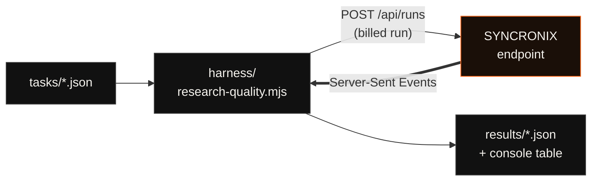

<p align="center">
  
</p>

<h1 align="center">SYNCRONIX Benchmarks</h1>

<p align="center">
  Does the research agent actually read and cite its sources — and what does each run cost?<br>
  <a href="https://syncronixai.xyz">Website</a> · <a href="https://github.com/SyncronixLabs/syncronix-docs">Docs</a> · <a href="https://github.com/SyncronixLabs/syncronix-research">Research</a>
</p>

---

## What is measured



| Metric | Definition |
|---|---|
| **Pages read** | Distinct pages successfully fetched and read in full (not search snippets) |
| **Findings citing a read page** | Bullets under *Findings* that link to at least one page that was read |
| **Unsourced findings** | Findings with no link |
| **Single-source findings** | Findings the agent marked *(single source)* |
| **Cited passages** | Passage-level citations the API attached to the report text |
| **Sources traced** | Report links that trace to a real search result or fetched page / all report links |
| **Repeated searches / fetches** | Identical queries or pages issued more than once in a run |
| **Cost** | List-price estimate from API-reported token usage plus search fees |
| **Within ceiling** | Cost ≤ the per-run ceiling ($0.20) |

## Latest results

*13 Nov 2026 · claude-sonnet-5-5 · local build of the production agent*

| Configuration | Task | Pages read | Findings citing a read page | Repeats | Cited passages | Cost |
|---|---|---|---|---|---|---|
| Baseline (production) | similar to T1 | 0 | — | 1 search | — | $0.082 |
| Protocol + dynamic-filtering tools | T1 | 3 | 5/5 | 3 searches + fetches | 0 | $0.106 |
| Protocol + dynamic-filtering tools | T2 | 2 | 1/4 | fetches | 0 | $0.085 |
| **Protocol + direct-call tools (current)** | T1 | 2 | 6/8 | none | 17 | **$0.069** |
| **Protocol + direct-call tools (current)** | T2 | 2 | 5/5 | none | 2 | **$0.040** |

**T1** — *How does Solana's Proof of History work, and is it being replaced?*
**T2** — *What is the current Node.js Active LTS release line and when does it reach end of life?*

> [!IMPORTANT]
> Single runs of two tasks. Treat the results as directional, not as statistically established.
> Raw data: [results/2026-11-13-research-quality.json](results/2026-11-13-research-quality.json) ·
> analysis: [syncronix-research](https://github.com/SyncronixLabs/syncronix-research/blob/main/notes/2026-11-grounded-web-research.md).

## Run the benchmark

Node.js 18+, no dependencies. **Each task starts one billed research run** on the server you point it at.

```bash
# a self-hosted SYNCRONIX instance
node harness/research-quality.mjs --base http://localhost:3100

# the public service: one run per visitor per day, so use a single task
node harness/research-quality.mjs --base https://syncronixai.xyz --tasks tasks/one.json
```

<details>
<summary><b>Options</b></summary>

| Option / variable | Default | Meaning |
|---|---|---|
| `--base` | `http://localhost:3100` | Endpoint to test |
| `--tasks` | `tasks/default.json` | JSON array of task strings |
| `--out` | `results/run-<timestamp>.json` | Where to write results |
| `SYNCRONIX_ADMIN_KEY` | — | Admin key of your own instance (lifts the per-visitor daily limit there) |
| `RUN_CEILING_USD` | `0.20` | Ceiling used for the *within ceiling* check |

</details>

<details>
<summary><b>Result file format</b></summary>

```json
{
  "base": "http://localhost:3100",
  "ranAt": "2026-11-13T04:50:00.000Z",
  "ceilingUsd": 0.2,
  "rows": [
    {
      "task": "…",
      "seconds": 23,
      "costUsd": 0.06853,
      "searches": 2,
      "repeatedSearches": 0,
      "pagesRead": 2,
      "repeatedFetches": 0,
      "findings": 8,
      "findingsCitingReadPage": 6,
      "unsourcedFindings": 0,
      "singleSourceFindings": 0,
      "citedPassages": 17,
      "sourcesTraced": "7/7",
      "withinCeiling": true,
      "notes": ["Source check: …", "Grounding: …"]
    }
  ]
}
```

A run refused before it starts records `refused`; a run that fails records `failed`.

</details>

## Repository layout

```
harness/research-quality.mjs   the benchmark runner (streams and scores each run)
tasks/default.json             two-task set used for the published results
tasks/one.json                 single task for the public service
results/                       published results (JSON)
```

<sub>Licensed under the [MIT License](LICENSE).</sub>
